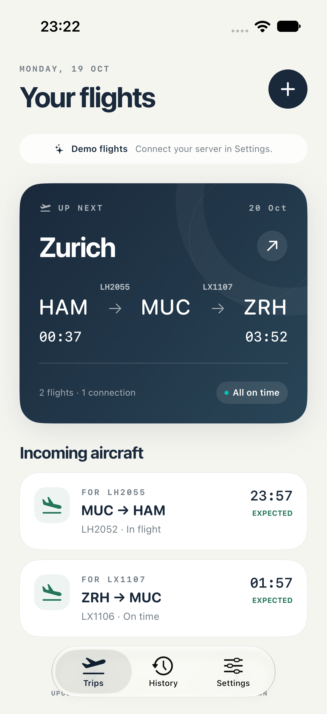
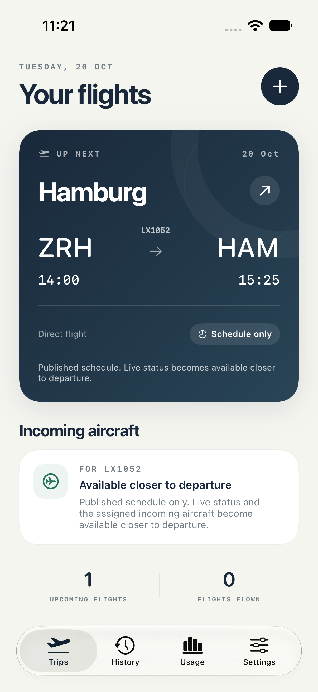
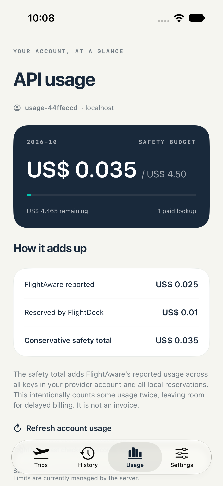
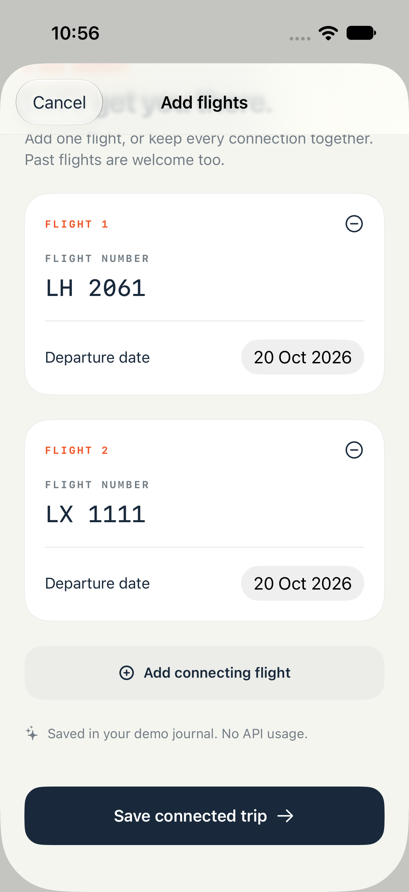
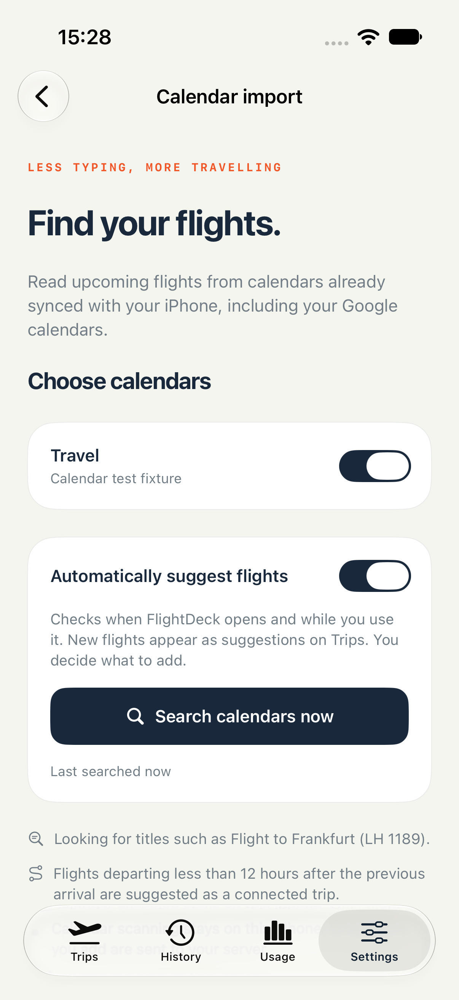
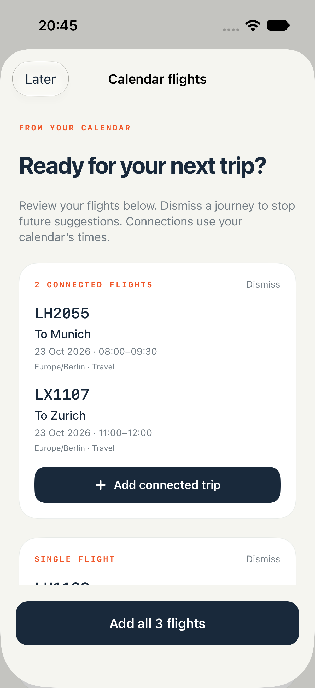
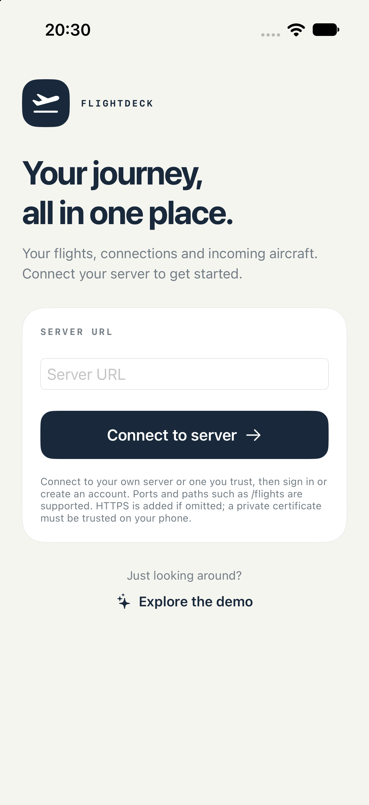
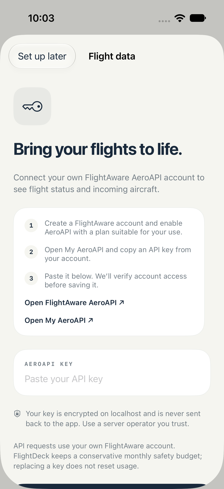

# FlightDeck

**Your journey, all in one place.**

A native iPhone flight companion for frequent travellers. Keep your upcoming flights, connections, assigned aircraft and each aircraft's previous flight together, so you can see what matters before you leave for the airport.

> **Real flight tracking requires a running FlightDeck server and your own FlightAware AeroAPI key.** You can host the Python server yourself or connect to one operated by someone you trust. Each user brings their own key. The built-in demo works without either requirement.

[Features](#your-journey-in-one-place) · [Calendar import](#add-flights-with-less-typing) · [Requirements](#what-you-need) · [Getting started](#getting-started) · [Setup guide](docs/SETUP.md)

## Your journey in one place

<table>
  <tr>
    <th>Your whole trip</th>
    <th>Schedules before departure</th>
    <th>API usage at a glance</th>
  </tr>
  <tr>
    <td><a href="previews/overview.png"></a></td>
    <td><a href="previews/schedule-overview.png"></a></td>
    <td><a href="previews/usage.png"></a></td>
  </tr>
  <tr>
    <td>A single overview for the journey, with incoming flights for each remaining leg.</td>
    <td>Published schedules appear first; live status and aircraft information follow when available.</td>
    <td>See your account's spending and the requests reserved against its safety budget.</td>
  </tr>
</table>

*Screenshots use demo or synthetic test data. Tap a screenshot to view it at full size.*

- **Follow the whole journey.** Save a direct flight or up to eight connected legs. Routes with one to three flights show flight numbers over the connecting arrows; longer journeys use a compact summary.
- **Watch your incoming aircraft.** See the previous flight of the aircraft assigned to each upcoming leg, alongside aircraft type and registration when the provider supplies them. Assignments are checked again as they change.
- **Keep useful flight details together.** View status, scheduled and updated times, and gates or terminals when available, with airport-local times. Advance schedules are clearly marked **Schedule only**.
- **Refresh without starting over.** Live information refreshes when more than 15 minutes old while the app is active. Pull down to request an update; server caching and budget controls still apply.
- **Build a flight journal.** The History tab keeps flights you have added. Saved itinerary numbers and dates remain; provider-derived details expire after 29 days.
- **Keep your account connected.** Sign in once and keep the session in the iPhone Keychain. Trips, provider credentials, caches and usage are separated by account.

## Add flights with less typing

Enter a flight number and departure date, and FlightDeck looks up the airports. Both `LX1055` and `LX 1055` are accepted and saved as `LX1055`. Add further legs to the same trip when you have a connection.

You can also find flights in calendars already synced with iOS Calendar:

- Select the calendars to search in **Settings → Calendar import**.
- Enable **Automatically suggest flights**, or use **Search calendars now** whenever you want.
- Review suggestions before adding them. Dismissed flights stay dismissed for that account on that device, including after restarting the app.
- Calendar entries such as `Flight to Frankfurt (LH 1189)` supply the flight number and date. Flights departing at or after the previous arrival and less than 12 hours later are suggested as a connected trip.

<table>
  <tr>
    <th>Add connected flights</th>
    <th>Choose your calendars</th>
    <th>Review suggested journeys</th>
  </tr>
  <tr>
    <td><a href="previews/add-connected-flights.png"></a></td>
    <td><a href="previews/calendar-settings.png"></a></td>
    <td><a href="previews/calendar-suggestions.png"></a></td>
  </tr>
</table>

Calendar scanning happens on the phone and makes no AeroAPI requests. Only flights you choose to add are sent to the server for normal budgeted lookup. FlightDeck reads selected calendars without editing their events. Google calendars work when synced with iOS Calendar. Automatic searches run while the app is active; connection grouping uses calendar times as a heuristic.

## What you need

| Component | Requirement |
| --- | --- |
| **iOS app** | An iPhone running iOS 17 or newer. Build the app from this repository using Xcode on a Mac, with your authorized signing team for a physical device. |
| **FlightDeck server** | A running Python 3.11+ backend, either self-hosted or provided by someone you trust. A Windows service installer is included. |
| **Flight data** | Your own FlightAware account with AeroAPI enabled and an API key suitable for the required endpoints. Provider usage may incur charges under your plan. |
| **Server connection** | An HTTPS endpoint reachable from the phone, with a certificate the phone trusts. Localhost HTTP is supported for development. |
| **Calendar import, optional** | Calendar permission and calendars synced with iOS Calendar. |

The data flow is **iPhone app → FlightDeck server → FlightAware AeroAPI**. The server stores your trips, protects the provider key, caches flight data and accounts for API usage. Each user registers on their chosen server and supplies their own provider key.

Server URLs can include a port and a reverse-proxy path, for example `https://server.example.com:8080/flights`. FlightDeck keeps that prefix on every request, such as `/flights/v1/server` and `/flights/v1/auth/login`. If you omit the scheme, the app adds `https://`.

## Getting started

### 1. Start the server

From the repository root on macOS or Linux:

```sh
cd server
python3 -m venv .venv
source .venv/bin/activate
python -m pip install -r requirements.lock
python -m flightdeck configure
python -m flightdeck run
```

The server listens at `127.0.0.1:8787`. For a physical phone, place it behind your HTTPS reverse proxy and use that reachable hostname in the app. The [setup guide](docs/SETUP.md#run-your-server) covers configuration, the [Windows service installer](docs/SETUP.md#windows-service), certificate trust, backups and account recovery.

### 2. Connect the app and add your key

1. Open [`app/FlightDeck.xcodeproj`](app/FlightDeck.xcodeproj) in Xcode and run the **FlightDeck** scheme.
2. Enter your server URL on the start page and connect.
3. Register a new account or sign in to an existing account on that server.
4. Follow the in-app guide to obtain and submit your FlightAware AeroAPI key.
5. Add a flight or search your calendars, then check the **Usage** tab as you use the app.

<table>
  <tr>
    <th>Connect to your server</th>
    <th>Bring your own API key</th>
  </tr>
  <tr>
    <td><a href="previews/start.png"></a></td>
    <td><a href="previews/api-key-setup.png"></a></td>
  </tr>
</table>

To try the interface first, choose **Explore the demo** on the start page. This uses local sample flights and makes no provider requests. The localhost address shown in the screenshot is a test-server example; enter your own server's address.

## Credentials and API costs

Your provider key is verified, encrypted on the server and used only there. It is never returned through a read-back endpoint or persisted in the iOS app. The server operator must be trusted because a running server can decrypt the key for provider calls. See [security and account isolation](server/SECURITY.md).

The connector checks a durable, per-account usage ledger before making paid requests. Its default monthly safety ceiling is **US$4.50**, leaving a margin below a US$5 target. It conservatively combines provider-reported usage with local reservations and uses caching to reduce requests. Administrators can lower the ceiling; changing or removing a key does not reset usage.

This is an application spending guard, not a guarantee of the provider's final bill or a substitute for provider-side limits. The [budget guide](server/BUDGET.md) explains the accounting, reviewed prices and limits. The app shows current usage and up to 12 months of history; editing limits in the app is planned.

## Project status and further documentation

FlightDeck is an early version built from source. Flight and aircraft coverage depend on the provider, airline and departure date. Push notifications, background polling, direct SWISS/Miles & More account import and missed-connection predictions are future work. Physical-device calendar behavior and Windows deployment still need real-device testing.

- [Setup and development](docs/SETUP.md) — server installation, app builds, calendar behavior, API endpoints and test commands.
- [Security](server/SECURITY.md) — sessions, encrypted credentials, account isolation, backups and migration.
- [Budget accounting](server/BUDGET.md) — spending reservations, caches and request safeguards.
- [Validation](VALIDATION.md) — checks performed and remaining testing limitations.
